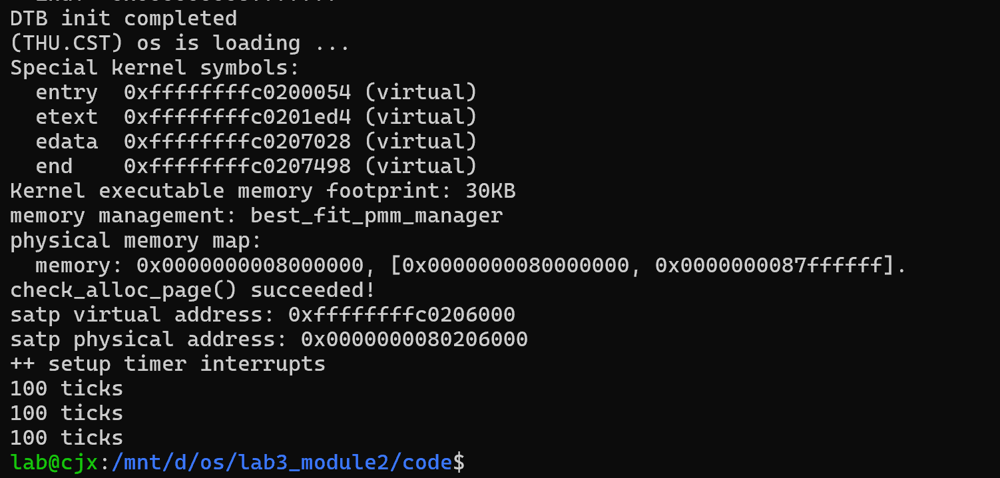
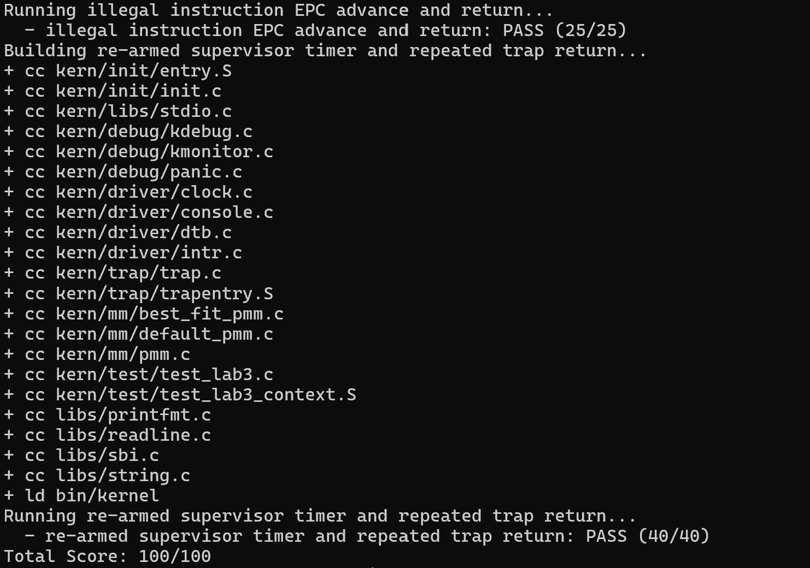

# 操作系统实验报告

## 实验基本信息

| 项目 | 内容 |
|------|------|
| 实验名称 | Lab 3：断，都可以断 |
| 小组成员 | 2413551-李睿、2411259-成钧翔、2412224-王泊凯 |
| 完成日期 | 2026-11-06 |
| 代码分支 | `os_project` 仓库的 `Lab3` 分支（内核工程位于 `code/`） |

本报告依据 `Lab3` 分支的源码和 `report/` 下的材料编写。第五节的日志是在 WSL 环境重新构建后的实测输出，编译与评分命令统一带 `-Dsbadaddr=stval`（原因见 2.2 节）。

### 小组分工

| 成员 | 负责的练习/模块 |
|------|----------------|
| 2413551-李睿 | Lab3 环境初始化（Lab2 接入、工程目录重组）、功能模块一：Trap 上下文恢复与 Trap 入口 |
| 2411259-成钧翔 | 功能模块二：中断与异常处理 |
| 2412224-王泊凯 | Best-Fit 分配器在 Lab3 框架中的移植与物理内存侧验证、整合测试与实验报告 |

报告分工：李睿负责模块一的需求分析、提示词与实现说明；成钧翔负责模块二提示词、实现与运行截图；王泊凯负责全篇汇总，补充测试与验证、环境说明和总结，并在 WSL 中复现 `make qemu` 与 `make grade`。

---

## 一、实验目的

1. 理解 RISC-V S 模式下一次 Trap 的完整路径：硬件按 `stvec` 跳到 `__alltraps`，`SAVE_ALL` 建立 Trap frame，`trap()` 分发处理，`__trapret` 执行 `RESTORE_ALL`，最后由 `sret` 回到被打断的执行流。
2. 掌握上下文保存与恢复的对称性：36 个槽位与 `struct trapframe` 一一对应；`sp` 既是恢复目标又是所有装载的基址；`sstatus` 与 `sepc` 必须以 Trap frame 中的当前值为准，而不是 CSR 中的旧值。
3. 区分中断与异常：`scause` 最高位为 1 表示中断，去掉该位后的编号决定处理分支；时钟中断需要每次重新武装定时器，非法指令与断点异常需要推进返回地址。
4. 理解异常返回地址的推进方式：按 `sepc` 处指令编码的低两位判断 16 位还是 32 位，而不是按异常类型写死偏移。
5. 理解时钟中断在系统中的位置：它是唯一与程序行为无关、周期性发生的打断源，也是后续抢占式调度的时间基准。
6. 学习用 spec（不变量、边界条件、验收输出）组织提示词，让 AI 生成代码后再用课程评分脚本验收，而不是只凭阅读判断代码对错。

---

## 二、实验环境

### 2.1 AI 工具

| 成员 | AI 编程工具 | 底层模型 | 备注 |
|------|------------|---------|------|
| 2413551-李睿 | VS Code 插件 | DeepSeek-V4-Flash | 模块一的需求分析、提示词设计与实现 |
| 2411259-成钧翔 | Codex 桌面应用 | 未记录 | 模块二实现与运行截图 |
| 2412224-王泊凯 | DeepSeek Harness | DeepSeek-V4.1-Flash | 报告汇总、整合验证 |


### 2.2 构建与运行环境

| 项目 | 环境 |
|------|------|
| 宿主系统 | Windows + WSL2 |
| 发行版 | Ubuntu 22.04.5 LTS（`Ubuntu-22.04`） |
| 交叉编译器 | `riscv64-unknown-elf-gcc 15.1.0 (g1b306039ac4)` |
| 工具链前缀 | `/opt/riscv-elf-toolchains/bin/riscv64-unknown-elf-` |
| 构建工具 | GNU Make 4.3 |
| 模拟器 | QEMU 4.1.1，`-bios default` 加载 OpenSBI v0.4 |
| 脚本解释器 | Python 3.10.12（`tools/inject.py`） |
| 内核链接基址 | `0xFFFFFFFFC0200000`（`tools/kernel.ld`） |
| 构建产物 | `bin/ucore.img`，本次构建 28712 字节 |
| 评分入口 | `make grade`（`tools/inject.py` 注入用例，`tools/grade.sh` 逐个编译运行，临时目录 `/tmp/lab3_grade`） |
| 模拟器参数 | `-machine virt -nographic -bios default -device loader,file=bin/ucore.img,addr=0x80200000` |

工具链需要说明一处差异。框架的 `SAVE_ALL` 用旧名读取该 CSR：

```asm
    csrr s3, sbadaddr
```

而 Ubuntu 22.04 的 binutils 已把 `sbadaddr` 更名为 `stval`，直接编译会失败：

```text
kern/trap/trapentry.S: Assembler messages:
kern/trap/trapentry.S:47: Error: unknown CSR `sbadaddr'
```

本次不改模块一的保存逻辑，而是在编译和评分命令上做等价映射 `DEFS=-Dsbadaddr=stval`。实测这样构建得到的内核与课程评分用例完全兼容（见第五节）。

---

## 三、实验整体逻辑分析

### 3.1 本章节的逻辑主线

本章只有一条主线：**一次 Trap 进来以后，怎样把现场完整地救回来，并在回来之前把该做的事做完。**

硬件在陷入时只做最少的动作：把 `pc` 写入 `sepc`、把原因写入 `scause`、把陷入前的特权级与中断使能写入 `sstatus` 的 SPP/SPIE，然后跳到 `stvec` 指向的地址。32 个通用寄存器与 `sstatus`、`sepc`、`stval`、`scause` 的保存、恢复全部由软件负责。于是实验被切成两段：

- **模块一负责"进得来、回得去"**：`__alltraps` 在 `SAVE_ALL` 之后把 Trap frame 首地址作为参数交给 `trap()`，`RESTORE_ALL` 再把 frame 中的状态写回寄存器和 CSR，最后由 `sret` 返回。这一段成立之前，任何 Trap 只会让内核停在入口或返回错误位置。
- **模块二负责"回来之前做什么"**：`interrupt_handler` 与 `exception_handler` 只修改 Trap frame 中的字段（主要就是 `epc`）和必要的全局状态（`ticks`、定时器），不直接碰真实寄存器。真正的寄存器仍然由模块一在返回时统一写回。

这样分工带来一个很重要的性质：**C 代码改 `tf->epc` 就等于改返回地址**。断点与非法指令的"跳过当前指令"、系统调用的"返回值通过 a0 带回"、调试器的"改 pc 继续执行"，本质都是同一件事。

本章的三个场景——断点、非法指令、时钟中断——共用同一个入口、同一个 Trap frame、同一条返回路径，差别只在 `trap_dispatch()` 之后进入哪个分支。这也是评分用例把它们分成三段（35 + 25 + 40）的原因：第一段验证"回得去"，后两段验证"回来前做对了"。

### 3.2 功能的逐步实现

1. **先完成 Lab2 接入与启动流程**（`kern/init/init.c` 中的 `idt_init()`、`pmm_init()`、`clock_init()`、`intr_enable()`）。理由：没有 `stvec` 就没有 Trap 入口，没有 `clock_init()` 就没有周期性的时钟中断，没有 `intr_enable()` 就连一次中断都不会发生。这一步让机器"可以被打断"，是后面所有验证的前提。
2. **再实现 `RESTORE_ALL`**。理由：这是唯一一段"一旦写错就完全回不来"的代码。它写错时表现为死循环或立刻崩溃，最容易定位；等到 handler 也写进去以后，两类错误会混在一起，很难判断是"没恢复对"还是"处理错了"。
3. **接着补全 `__alltraps` 的传参**。理由：只有把 frame 交给 C 代码，模块二修改 `epc` 的语义才能生效；这两步合起来才构成"进→改→回"的闭环。
4. **最后实现模块二的两个 handler**。理由：闭环可靠之后，处理逻辑的正确性才有意义；而且评分脚本本身也是按"断点返回（35）→ 非法指令（25）→ 持续时钟（40）"的顺序设计的，前一段不通，后两段的结果没有参考价值。

---

## 四、实验内容与实现

### 4.1 功能模块一：Trap 上下文恢复与 Trap 入口功能

**负责人：** 2413551-李睿

#### 模块功能描述

**需要实现/修改的函数：**

```asm
// kern/trap/trapentry.S
.macro SAVE_ALL        // 框架已有：建立 36 * 8 = 288 字节的 Trap frame
.macro RESTORE_ALL     // 本模块实现：从 Trap frame 恢复现场
.globl __alltraps      // 本模块补全：SAVE_ALL → trap() → 顺序落到 __trapret
.globl __trapret       // 框架已有：RESTORE_ALL; sret
```

```c
// kern/trap/trap.h（框架已有，本模块只读）
struct pushregs {
    uintptr_t zero, ra, sp, gp, tp, t0, t1, t2, s0, s1,
              a0, a1, a2, a3, a4, a5, a6, a7,
              s2, s3, s4, s5, s6, s7, s8, s9, s10, s11,
              t3, t4, t5, t6;      // 32 个 uintptr_t，顺序即 x0..x31 的 ABI 顺序
};
struct trapframe {
    struct pushregs gpr;           // 0*8  ~ 31*8
    uintptr_t status;              // 32*8，sstatus
    uintptr_t epc;                 // 33*8，sepc
    uintptr_t badvaddr;            // 34*8，stval
    uintptr_t cause;               // 35*8，scause
};

// kern/trap/trap.c（框架已有，本模块只依赖签名）
void trap(struct trapframe *tf);
```

Trap frame 的槽位与来源：

| 槽位 | 内容 | 写入方式 |
|------|------|----------|
| 0 | x0（恒为 0） | `STORE x0, 0*REGBYTES(sp)` |
| 1 | x1（ra） | `STORE x1, 1*REGBYTES(sp)` |
| 2 | **Trap 发生前的 sp** | `csrrw s0, sscratch, x0` 取出后 `STORE s0, 2*REGBYTES(sp)` |
| 3 ~ 31 | x3 ~ x31 | 逐个 `STORE` |
| 32 | sstatus | `csrr s1, sstatus` 后存入 |
| 33 | sepc | `csrr s2, sepc` 后存入 |
| 34 | sbadaddr | `csrr s3, sbadaddr` 后存入 |
| 35 | scause | `csrr s4, scause` 后存入 |

**功能说明：**

- **在系统中的位置**：`idt_init()` 把 `stvec` 设为 `&__alltraps`（Direct 模式），并把 `sscratch` 清 0 表示当前处于内核态。此后任何 Trap（断点、非法指令、时钟中断）都从这里进入。
- **`SAVE_ALL` 的一个细节**：它先把 Trap 前的 `sp` 写进 `sscratch` 再下移栈指针，所以 2 号槽位保存的不是"当前 sp"，而是"被打断执行流的栈顶"。恢复时 `LOAD x2, 2*REGBYTES(sp)` 本身没问题，问题是这条指令必须在所有以 `sp` 为基址的装载之后执行——一旦 x2 被改写，后续装载的地址就全错了，所以它只能放在最后一条。
- **恢复顺序的依据**：CSR 与通用寄存器是两套独立的存储，先写 `sstatus`、`sepc` 不会影响后续的寄存器装载；而 `sp` 是所有装载的基址，只能放在最后一步。用于 `csrw` 的临时寄存器 `t0` 本身也要从 5 号槽位取回，否则返回后 `t0` 与被中断程序看到的「值」不一致。
- **`__alltraps` 的接口**：RISC-V 调用约定第一个整型参数放在 `a0`，因此 `mv a0, sp; jal trap` 就是把 frame 首地址交给 `trap()`。`jal` 会写 `ra`，但此时 `ra` 已保存在 1 号槽位，返回时从 frame 恢复，不冲突；`jal trap` 正常返回后会顺序落到 `__trapret`，`sp` 保持不变。
- **`sret` 的语义**：`pc ← sepc`，特权级按 `sstatus.SPP` 设置，`SIE ← SPIE`。因此返回位置与返回后的中断使能，完全取决于模块一写回的 `sepc` 与 `sstatus`。

#### 实现代码

```asm
    .macro RESTORE_ALL

    #lab3 function1 2413551
    # 先恢复 sstatus / sepc：trap() 可能已通过 tf->epc 修改返回地址，
    # 因此必须以 Trap frame 中的当前值为准，不能沿用 CSR 里的旧值
    LOAD t0, 32*REGBYTES(sp)
    csrw sstatus, t0
    LOAD t0, 33*REGBYTES(sp)
    csrw sepc, t0

    # 恢复通用寄存器（x0 恒为 0，x2(sp) 最后恢复）
    LOAD x1, 1*REGBYTES(sp)
    LOAD x3, 3*REGBYTES(sp)
    ...
    LOAD x31, 31*REGBYTES(sp)

    # sp 是所有装载的基址寄存器，只能最后恢复；
    # 槽位 2 保存的是 Trap 发生前的 sp（由 SAVE_ALL 经 sscratch 写入）
    LOAD x2, 2*REGBYTES(sp)

    .endm

    .globl __alltraps
    .align(2)
__alltraps:
    SAVE_ALL

    #lab3 function1 2413551
    # 把当前 Trap frame 首地址（即 sp）作为第一个参数传给 trap(struct trapframe *)
    mv a0, sp
    jal trap

    .globl __trapret
__trapret:
    RESTORE_ALL
    # return from supervisor call
    sret
```

（x3 ~ x30 的装载与 x1、x31 同构，报告从略，完整代码见 `code/kern/trap/trapentry.S`。）

#### 最终提示词

提示词采用四段式结构，完整文本见 `report/prompt.md` 中"功能模块一"一节，这里说明每段承担的作用：

- **PROMPT（任务与边界）**：只修改 `kern/trap/trapentry.S` 中 `#lab3 function1 YOUR CODE` 标记的位置，把 `YOUR CODE` 换成学号 2413551；不得修改 `SAVE_ALL`、`struct trapframe`、`void trap(struct trapframe *tf)` 的签名，不得改动 `__alltraps`/`__trapret` 两个符号名，不得删除 `sret`；禁止在文件里引入用户态栈切换、调度等无关功能。
- **RELY（可依赖的事实）**：给出 `libs/riscv.h` 中 `STORE = sd`、`LOAD = ld`、`REGBYTES = 8`（故 36 × 8 = 288 字节且满足 16 字节对齐），给出 `struct trapframe` 的完整布局，并逐条说明已有 `SAVE_ALL` 的行为——特别是 x2 经 `sscratch` 转存的细节。这一段的作用是不让模型"凭记忆"编造宏名或偏移。
- **GUARANTEE（对外承诺）**：恢复后 32 个通用寄存器的值与 Trap 前一致（x0 仍为 0，x2 恢复为 Trap 前的 sp）；`sstatus`、`sepc` 被写成 frame 中 32/33 槽位的当前值；除这两个 CSR 外不改变 `sscratch`。
- **SPECIFICATION（验收细节）**：把四个容易写错的场景写成 Case——①正常恢复；②C 代码改过 `tf->epc`，因此必须用 frame 的值而不是 CSR 旧值；③`sp` 只能最后恢复；④临时寄存器也要归位。Requirements 再补充"不得写入 frame 中不存在的槽位""不得依赖 caller-saved 寄存器的残留值"等硬性约束。

#### 实现迭代过程

本模块经过三次迭代。

##### 第一次迭代

**遇到的问题：**

- **断点返回后重复触发**。恢复 `sepc` 时用的是 `csrr` 读到的 CSR 旧值，而不是 Trap frame 的 33 号槽位。模块二已经把 `tf->epc` 推进到下一条指令，但这个推进在恢复路径上被丢掉了，`sret` 于是回到 `ebreak` 自身，形成"进入—返回—再进入"的死循环。
- **寄存器大面积错位**。生成的代码把 `LOAD x2, 2*REGBYTES(sp)` 放在通用寄存器恢复序列的中间。sp 一旦被装回 Trap 前的值，后续所有 `LOAD ... (sp)` 都在读被中断程序的栈，而不是 Trap frame。

**问题解决策略：**

- 在 SPECIFICATION 增加 Case 2：返回地址一律取 frame 槽位 33 的当前值，并说明"否则会重复执行同一条异常指令"。
- 增加 Case 3：明确 `sp` 既是恢复目标又是装载基址，必须最后恢复。

**最终结果：** 断点可以返回一次，但用例 1 的寄存器一致性检查仍然失败。

##### 第二次迭代

**遇到的问题：**

- **临时寄存器未归位**。用 `t0` 做 `csrw sstatus` / `csrw sepc` 的中间寄存器之后，没有再从 frame 取回 `t0`，返回后该寄存器的值与 Trap 前不一致。用例 1 会逐个比对通用寄存器，这一条足以让它失败。
- **`__alltraps` 多调整了栈指针**。为了"满足 16 字节对齐"，生成代码在 `jal trap` 前做了一次 `addi sp, sp, -16`，但返回后没有撤回。结果是 `trap()` 拿到的不是 frame 首地址，`__trapret` 也从错位地址开始恢复。

**问题解决策略：**

- 增加 Case 4：用作 CSR 装载的临时寄存器必须随后从 frame 恢复，不能被永久破坏。
- 在 `__alltraps` 的 Post-Condition 中写明：`a0` 必须等于当前 sp；`jal trap` 返回后 sp 不得改变，控制流顺序落到 `__trapret`；288 字节本身是 16 的整数倍，不需要额外调整栈指针。

**最终结果：**

- 编译通过，`make grade` 用例 1 输出 `PASS (35/35)`；
- 内核端输出 `Breakpoint at 0xffffffffc02019d8`，说明 `tf->epc` 的推进经恢复路径生效。

##### 第三次迭代

**遇到的问题：** 换到 Ubuntu 22.04 的新工具链后汇编失败：`Error: unknown CSR `sbadaddr'`。

**问题解决策略：** 不在模块一里改动 `SAVE_ALL`（它是框架代码，也是保存逻辑的唯一依据），而在编译参数上做映射 `-Dsbadaddr=stval`；提示词补一条"遇到 CSR 更名用 `DEFS` 适配，不要为此改保存/恢复逻辑"。

**最终结果：** 编译通过，用例 1 稳定 35/35。

**关键改进点总结：**

1. 把"CSR 与 frame 谁优先"写成 Case，而不是指望模型自己想到 C 代码会改 `epc`。
2. 把 `sp` 的恢复顺序上升为 Requirements 级别的硬约束，避免它在不同生成结果中反复出错。
3. 明确"288 字节已满足 16 字节对齐"，减少了模型为对齐而擅自调整栈指针的行为。
4. 把工具链差异（`sbadaddr` 更名）写成适配方式，而不是修改框架代码。

---

### 4.2 功能模块二：中断与异常处理

**负责人：** 2411259-成钧翔

本模块在 `kern/trap/trap.c` 中实现 `interrupt_handler()` 和 `exception_handler()`。已有的 `trap_dispatch()` 按 `scause` 的符号位区分中断与异常；两个处理函数根据 Trap frame 中的原因执行相应操作，再交回框架统一恢复现场。

#### 模块功能描述

**需要实现/修改的函数：**

```c
// kern/trap/trap.c
void interrupt_handler(struct trapframe *tf);   // 本模块实现
void exception_handler(struct trapframe *tf);   // 本模块实现

static inline void trap_dispatch(struct trapframe *tf);  // 框架已有，按 cause 分流
void trap(struct trapframe *tf);                         // 框架已有，调用 trap_dispatch
```

**功能说明：**

- **分流规则**：`trap_dispatch()` 用 `(intptr_t)tf->cause < 0` 判断最高位。第 63 位为 1 是中断，进入 `interrupt_handler()`；为 0 是异常，进入 `exception_handler()`。这样写比"判断 cause 是否大于某个常数"更稳妥，因为它直接对应 RISC-V 对 `scause` 的编码规定。
- **中断处理**：先算 `interrupt_bit = 1 << (sizeof(tf->cause) * 8 - 1)`，再用 `cause = tf->cause & ~interrupt_bit` 去掉标志位。S 模式时钟中断（`IRQ_S_TIMER`）是本章真正要跑起来的事件：每次都要调用 `clock_set_next_event()` 重新装定下一次比较值，然后 `++ticks`；每满 `TICK_NUM`（100）次打印一行 `100 ticks`；累计到 `SHUTDOWN_AFTER` 次（默认 3 次，即 300 tick）后调用 `sbi_shutdown()` 让 QEMU 退出。其他已知中断用一张指定初始化器构造的表映射成字符串（例如 S 模式软件中断输出 `Supervisor software interrupt`）；表里没有的原因先打印 `Unknown interrupt: cause %lu`，再 `print_trapframe(tf)`。
- **异常处理**：只对 `CAUSE_ILLEGAL_INSTRUCTION`（0x2）和 `CAUSE_BREAKPOINT`（0x3）做"可恢复"处理：先按类型输出 `Illegal instruction at ...` 或 `Breakpoint at ...`，然后读取 `tf->epc` 处指令的低半字，按低两位判断长度——不等于 `0b11` 是 16 位指令，推进 2 字节；否则是 32 位指令，推进 4 字节。其他异常只 `print_trapframe(tf)`，**不推进 epc**，因为没有恢复手段的异常继续执行只会把问题放大。
- **为什么时钟中断不改 `epc`**：时钟中断的 `sepc` 指向被打断的那条指令，它本身没有出错，不需要跳过；只有非法指令和断点才需要"越过去"。
- **`SHUTDOWN_AFTER` 的取值**：评分用例 3 要等到 `ticks >= 200` 才打印 PASS。若阈值取 1（100 tick 就关机），内核会在测试打印之前退出，用例直接失败；取 3 留出 100 tick 余量，同时保证 `make qemu` 能在数秒内正常结束。

#### 实现代码

```c
//lab3 function2 2411259
void interrupt_handler(struct trapframe *tf) {
    const uintptr_t interrupt_bit = (uintptr_t)1 << (sizeof(tf->cause) * 8 - 1);
    const uintptr_t cause = tf->cause & ~interrupt_bit;
    static const char *const interrupt_names[] = {
        [IRQ_U_SOFT] = "User software interrupt",
        [IRQ_S_SOFT] = "Supervisor software interrupt",
        [IRQ_H_SOFT] = "Hypervisor software interrupt",
        [IRQ_M_SOFT] = "Machine software interrupt",
        [IRQ_U_TIMER] = "User timer interrupt",
        [IRQ_H_TIMER] = "Hypervisor timer interrupt",
        [IRQ_M_TIMER] = "Machine timer interrupt",
        [IRQ_U_EXT] = "User external interrupt",
        [IRQ_S_EXT] = "Supervisor external interrupt",
        [IRQ_H_EXT] = "Hypervisor external interrupt",
        [IRQ_M_EXT] = "Machine external interrupt",
    };

    if (cause == IRQ_S_TIMER) {
        clock_set_next_event();
        ++ticks;
        if (ticks % TICK_NUM == 0) {
            print_ticks();
            if (ticks / TICK_NUM == SHUTDOWN_AFTER) {
                sbi_shutdown();
            }
        }
    } else if (cause < sizeof(interrupt_names) / sizeof(interrupt_names[0]) &&
               interrupt_names[cause] != NULL) {
        cprintf("%s\n", interrupt_names[cause]);
    } else {
        cprintf("Unknown interrupt: cause %lu\n", (unsigned long)cause);
        print_trapframe(tf);
    }
}

/* Handle recoverable instruction exceptions and preserve the fallback. */
void exception_handler(struct trapframe *tf) {
    const char *name;
    switch (tf->cause) {
    case CAUSE_ILLEGAL_INSTRUCTION:
        name = "Illegal instruction";
        break;
    case CAUSE_BREAKPOINT:
        name = "Breakpoint";
        break;
    default:
        print_trapframe(tf);
        return;
    }

    cprintf("%s at 0x%016lx\n", name, (unsigned long)tf->epc);
    /* The kernel test instructions are 16- or 32-bit and readable at sepc. */
    uint16_t parcel = *(const volatile uint16_t *)tf->epc;
    tf->epc += (parcel & 3) == 3 ? 4 : 2;
}
```

文件顶部的关机阈值定义为可覆盖形式，便于测试时用编译参数调整：

```c
#define TICK_NUM 100
#ifndef SHUTDOWN_AFTER
/* The starter has no shutdown limit; count printed tick intervals. */
#define SHUTDOWN_AFTER 3
#endif
```

#### 最终提示词

完整文本见 `report/prompt.md` 中"功能模块二"一节，关键约束如下：

- **修改范围**：只改 `trap.c` 的模块二区域，保留 `lab3 function2` 标记并把 `YOUR CODE` 替换为 2411259；允许补充头文件与 `SHUTDOWN_AFTER` 默认值；不得改动 Trap frame 布局、`trap_dispatch()` 的分流逻辑、汇编入口和返回流程，不得修改课程测试与评分脚本。
- **时钟行为**：每次 S 模式时钟中断都重设下一次事件并 `++ticks`；每 100 次打印一次；累计 `SHUTDOWN_AFTER` 次后 `sbi_shutdown()`；处理期间不修改 `epc`。
- **输出契约**：监督者软件中断输出 `Supervisor software interrupt`；未知中断先输出 `Unknown interrupt: cause 15` 这样的十进制原因号，再打印 TrapFrame；非法指令与断点输出类型和触发地址。
- **推进规则**：读 `tf->epc` 处低半字，按低两位判断 2 或 4 字节，不要按异常类型写死偏移。
- **兜底**：其他异常调用 `print_trapframe(tf)`，不推进 `epc`。

#### 实现迭代过程

本模块经过三次迭代。

##### 第一次迭代

**遇到的问题：**

- **只中断一次**。生成的代码在时钟分支里只做了 `++ticks` 和打印，没有调用 `clock_set_next_event()`。定时器是一次性比较器，不重装就再也不会触发，于是 `100 ticks` 只出现一次，用例 3 永远等不到 200 tick。
- **分支永远进不去**。代码直接 `switch (tf->cause)`，没有去掉最高位的中断标志。实际的 `cause` 是 `0x8000000000000005`，而 `case IRQ_S_TIMER` 写的是 `5`，永远不匹配，时钟中断被当成未知中断处理。
- **关机过早**。关机条件写成「打印第一行就关机」，`make qemu` 只输出一行 `100 ticks` 便退出；评分用例 3 要求内核活到 200 tick，直接失败。

**问题解决策略：**

- 在 RELY 中写明 `scause` 的编码：最高位是中断标志，处理前必须先按位取反去掉。
- 在 SPECIFICATION 中把"每次中断都要重新装定定时器"写成第一条，并明确 `SHUTDOWN_AFTER` 是一个可编译覆盖的阈值，验收标准是「make qemu 连续输出三次 100 ticks 后正常退出」。

**最终结果：** `make qemu` 能连续输出三次 `100 ticks` 并正常退出；但评分用例 2 仍然失败。

##### 第二次迭代

**遇到的问题：**

- **未知异常没有兜底输出**。`exception_handler` 的 default 分支只打印一行提示，没有调用 `print_trapframe(tf)`。评分用例 2 会以 `cause = 20` 直接调用该函数，并检查输出中是否出现 `cause    0x00000014`——这一行恰由 `print_trapframe()` 打印，缺失即判失败。
- **`epc` 推进写死为 4**。本实验工具链启用了压缩指令扩展，`ebreak` 被汇编成 16 位的 `c.ebreak`（编码 `0x9002`），固定加 4 会跳过紧跟其后的一条有效指令，返回位置错误。

**问题解决策略：**

- 在 SPECIFICATION 中补充"其他异常调用 `print_trapframe(tf)`，不擅自推进 `epc`"。
- 把推进规则改写为"读 `sepc` 处指令低半字，按低两位判断 2/4 字节，不要按异常类型写死偏移"。

**最终结果：** 用例 2 输出 `Illegal instruction at 0xffffffffc0201988`、`Supervisor software interrupt`、`Unknown interrupt: cause 15` 与 `cause    0x00000014`，PASS（25/25）。

##### 第三次迭代

**遇到的问题：**

- 未知中断的原因号用 `0x%x` 输出，得到 `Unknown interrupt: cause 0xf`，与评分脚本按 `Unknown interrupt: cause 15` 做字面匹配的要求不符。
- 地址用 `%08x` 输出时只能看到低 32 位，对 `0xffffffffc02019d8` 这样的高地址会截断。

**问题解决策略：**

- 原因号改用 `%lu` 十进制输出，与课程脚本的匹配串保持一致。
- 地址改用 `%016lx` 输出完整的 64 位值，便于和 `sepc` 对照。

**最终结果：** 三个用例全部通过，总分 100/100。

**关键改进点总结：**

1. 把 `scause` 的位域规则写进 RELY，避免"直接 switch 原始 cause"这种结构性错误。
2. 把定时器"一次性比较器、必须重装"写成硬性要求，而不是笼统的"处理时钟中断"。
3. 把评分脚本要求的具体字符串（十进制原因号、`cause    0x00000014`）写进验收条件，让输出格式成为 spec 的一部分。
4. 明确"无恢复手段的异常不推进 epc"，避免把不可恢复的错误变成静默的死循环。

---

## 五、测试与验证

### 5.1 QEMU 正常启动与时钟中断

在 WSL 中编译内核并运行 `make qemu`（`make qemu DEFS=-Dsbadaddr=stval`）。启动日志显示 DTB 初始化、Best-Fit 自检成功，随后内核设置时钟中断，连续输出三次 `100 ticks`，达到当前实现的统计阈值后关机，终端返回命令提示符。实测退出码为 0。

```text
DTB init completed
(THU.CST) os is loading ...
Special kernel symbols:
  entry  0xffffffffc0200054 (virtual)
  etext  0xffffffffc0201ed4 (virtual)
  edata  0xffffffffc0207028 (virtual)
  end    0xffffffffc0207498 (virtual)
Kernel executable memory footprint: 30KB
memory management: best_fit_pmm_manager
physical memory map:
  memory: 0x0000000008000000, [0x0000000080000000, 0x0000000087ffffff].
check_alloc_page() succeeded!
satp virtual address: 0xffffffffc0206000
satp physical address: 0x0000000080206000
++ setup timer interrupts
100 ticks
100 ticks
100 ticks
```



### 5.2 课程评分测试

运行框架自带的 `make grade`（带 `DEFS=-Dsbadaddr=stval`），脚本对三个用例分别 `make clean`、重新编译、用 QEMU 运行并检查关键输出：

```text
  - trap entry, register restore, and breakpoint EPC: PASS (35/35)
  - illegal instruction EPC advance and return: PASS (25/25)
  - re-armed supervisor timer and repeated trap return: PASS (40/40)
Total Score: 100/100
```



截图保留了非法指令返回 25/25、持续时钟中断 40/40 与总分 100/100；用例 1 的输出在截图上方的较早位置，未进入画面，其内核端输出见 5.3 节。

### 5.3 三个用例的内核端输出

**用例 1（`GRADE_LAB3_CONTEXT`，35 分）：Trap 入口、寄存器恢复与断点返回。** 测试代码先给 `t0~t2`、`s0`、`s1`、`a1~a7`、`s2~s11`、`t3~t6` 写入哨兵值，再执行 `ebreak`；返回后逐个比对寄存器。输出为：

```text
Breakpoint at 0xffffffffc02019d8
[Test 1] Trap entry and breakpoint return: PASS (35/35)
```

这一行同时证明两件事：`__alltraps` 把 Trap frame 正确交给了 `trap()`（否则不会有 `Breakpoint at ...`），以及 `RESTORE_ALL` 把 32 个通用寄存器恢复到了 Trap 前的值（否则寄存器比对失败）。

**用例 2（`GRADE_LAB3_ILLEGAL`，25 分）：非法指令的返回地址推进与处理兜底。** 测试执行一条 4 字节非法指令，再直接以构造的 Trap frame 调用两个 handler，检查输出：

```text
Illegal instruction at 0xffffffffc0201988
Supervisor software interrupt
Unknown interrupt: cause 15
trapframe at 0xffffffffc0205eb0
  ...
  status   0x00000000
  epc      0x00000000
  badvaddr 0x00000000
  cause    0x00000014
[Test 2] Illegal instruction return: PASS (25/25)
```

其中 `Illegal instruction at ...` 证明非法指令分支被识别，「Unknown interrupt: cause 15` 与 `cause    0x00000014` 证明两条兜底路径都会打印完整 Trap frame。

**用例 3（`GRADE_LAB3_TIMER`，40 分）：持续时钟中断与重复 Trap 返回。** 测试先确认 `ticks` 在开中断前为 0，然后等待计数到达 200：

```text
++ setup timer interrupts
100 ticks
100 ticks
[Test 3] Sustained supervisor timer: PASS (40/40, ticks=201)
```

PASS 行打印的是测试读到的实时 tick 数，因此可能略大于 200（本次重放为 201）；评分脚本按 `ticks=200` 做子串匹配，正式评分运行中该串出现并通过（40/40）。用例 3 能通过，说明每次时钟中断都重新装定了定时器，且每次 Trap 返回后内核都能继续运行。

### 5.4 复现方式

```bash
# 构建
make clean
make DEFS=-Dsbadaddr=stval

# 正常启动（连续输出三次 100 ticks 后关机）
make qemu DEFS=-Dsbadaddr=stval

# 课程评分（注入用例后逐个编译运行）
make grade DEFS=-Dsbadaddr=stval
```

---

## 六、实验总结与收获

### 对操作系统的理解

1. **Trap 与函数调用是两种不同的控制转移**。函数调用由软件发起，只需遵守 ABI 的调用者/被调用者保存约定；Trap 由硬件发起，被打断的代码事先毫不知情，因此必须保存完整寄存器现场。OS 原理中的"上下文切换"在这之上还要换栈、换页表，本实验做的是它的前半段——同一个内核栈上的现场保存与恢复。
2. **硬件只做最少的事，剩下的都靠软件的自觉**。陷入时硬件只写 `sepc`、`scause`、`sstatus` 并跳到 `stvec`，通用寄存器、`sstatus`、`stval` 全要软件自己存。这意味着 Trap 处理的正确性完全取决于内核代码是否与硬件约定严格对齐：槽位错一个、`sp` 早恢复一步，都会表现为难以定位的崩溃。反过来，`sret` 之前的 CSR 写回是整个信任链的最后一环。
3. **Trap frame 既是现场快照，也是一个可被修改的控制块**。模块二改 `tf->epc` 就等于改返回地址；断点调试、系统调用返回值、信号处理，本质都是同一机制的不同用法。把"保存/恢复"和"处理逻辑"分成两个模块，正是为了让"改什么"和"怎么写回硬件"互不干扰。
4. **时钟中断是唯一与程序行为无关的事件**。它依赖每次重新装定比较值才能持续发生；忘记重装不会崩溃，只会让系统安静地不再被打断——这类"看起来正常"的错误，比崩溃更难发现。本实验里连续出现的 `100 ticks` 就是它仍在工作的直接证据。

### OS 原理中重要、但本实验没有覆盖的知识点

- **用户态 Trap 与系统调用**：本实验全程在内核态（SPP = 1、`sscratch` = 0），没有涉及 `sscratch` 保存用户栈、SPP = 0 返回 U 模式的路径。
- **缺页异常与按需分页**：`stval` 里存的是出错地址，缺页异常（cause 12/13/15）据此决定加载哪一页，本实验只把 `stval` 存进 frame，没有真正使用。
- **中断嵌套、中断屏蔽与下半部**：本实验在中断处理中不开中断，也没有区分"上半部快速处理"和"下半部延迟处理"。
- **时钟驱动的抢占式调度**：本实验只累计 `ticks` 并打印，没有就绪队列、时间片和 `switch_to`；`ticks` 在真实系统中是调度器的输入。
- **SMP 与 per-CPU 状态**：QEMU 只启动了一个 hart，没有涉及多核下的 `stvec` 独立设置、核间中断与锁。

### AI 协作开发的经验

- **先写不变量，再写提示词**。槽位编号、"`sp` 最后恢复"、"CSR 以 frame 为准"这些条件，比"请实现 Trap 返回"这种功能描述更能约束生成结果；它们恰好也是评审时最容易被问到的点。
- **把评分脚本的输出当验收标准**。`Breakpoint at`、`Unknown interrupt: cause 15`、`cause    0x00000014` 这些字符串是硬性契约，写进 spec 比写"输出正确的调试信息"有效得多。
- **区分编译期错误与运行期错误**。`sbadaddr` 更名只在编译期暴露，推进 `epc`、重装定时器只在运行期暴露；前者靠编译器，后者只能靠实际跑 QEMU 与评分用例。
- **不以 AI 的复述作为证据**。本次所有结论都以实际运行日志为准：编译输出、`.qemu.*.out` 的内核端输出、`make grade` 的得分，三者互相印证后才写进报告。

---

## 附录：材料位置

| 材料 | 位置 |
|------|------|
| 内核工程 | `code/` |
| 提示词汇总 | `report/prompt.md` |
| 运行与评分截图 | `report/images/` |
| 评分脚本 | `code/tools/grade.sh`、`code/tools/inject.py` |
