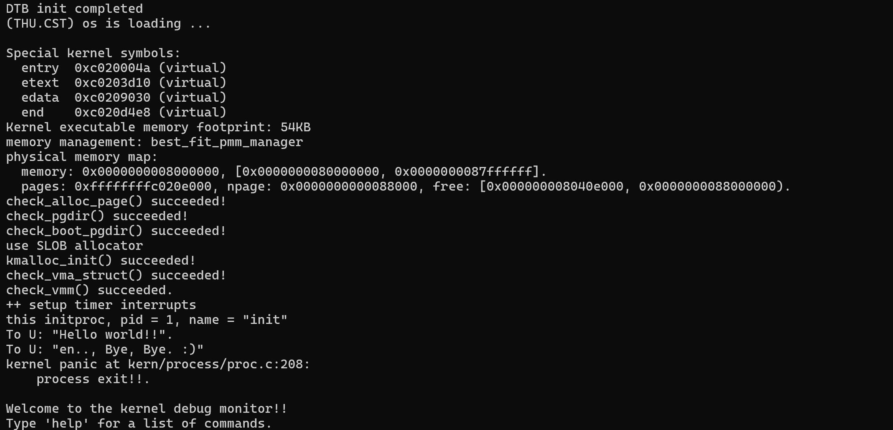

# 操作系统实验报告

## 实验基本信息

| 项目 | 内容 |
|------|------|
| **实验名称** | Lab 4: 进程管理 |
| **小组成员** | 2413551-李睿、2412224-王泊凯、2411259-成钧翔 |
| **报告更新日期** | 2026-11-20 |

### 小组分工

| 成员 | 负责的练习/模块 |
|------|----------------|
| 2413551-李睿 | A，虚拟内存页操作与进程系统初始化 |
| 2412224-王泊凯 | B，实现 `kernel_thread()`、`do_fork()`、`copy_thread()`、`copy_mm()` |
| 2411259-成钧翔 | C，实现 `cpu_idle()`、`schedule()`、`proc_run()`、`switch_to()`，进行整合测试并记录结果 |

---

## 一、实验目的

本实验的主要目的是：

1. 实现虚拟页映射的建立、替换和解除，理解页表项、物理页引用计数与 TLB 的关系。
2. 理解 PCB、线程内核栈、TrapFrame 和 context 的作用，创建 idleproc 和 initproc。
3. 通过线程选择、Sv39 页表切换和寄存器现场恢复，使内核线程获得 CPU 并能多次切换。
4. 用四段式提示词表达功能边界与行为规格，结合源码、QEMU 输出和课程测试核验结果。

---

## 二、实验环境

| 成员 | AI 编程工具 | 底层模型 | 备注 |
|------|------------|---------|------|
| 2413551-李睿 | VS Code 内置 Copilot | DeepSeek-V4-Flash | 无 |
| 2412224-王泊凯 | DeepSeek Harness | DeepSeek-V4.1-Flash（deepseek-official/deepseek-flash，reasoning=max） | 工具与模型信息参照前次实验报告填写 |
| 2411259-成钧翔 | Codex 桌面应用 | 未记录具体版本 | 辅助调度、上下文切换实现与运行测试 |

**说明：**
- **AI 编程工具**：指具体使用的终端工具、编辑器插件、桌面应用或浏览器界面
- **底层模型**：指该工具使用的大语言模型及版本

本次整合验证在 Windows 的 WSL 环境中进行，目标架构为 RISC-V RV64，使用
`riscv64-unknown-elf-gcc 15.1.0` 和 QEMU `virt` 平台。QEMU 使用已有的 4.1.1
安装路径，设备树探测结果为 128 MB 物理内存，OpenSBI 为内核提供底层定时等服务。
代码基线为仓库 Lab4 分支，本地工作目录为 `D:/os/lab4_publish/code`。

---

## 三、实验整体逻辑分析

### 3.1 本章节的逻辑主线

本实验把已有的物理页管理和 Trap 恢复机制接入线程管理。先维护虚拟地址映射，
再用 PCB、独立内核栈和初始现场描述线程，最后由调度器选择线程并恢复其执行现场。
本阶段的内核线程共享内核地址空间，地址空间框架采用预映射方式。

### 3.2 功能的逐步实现

1. 接入 Lab2 的物理页管理和 Lab3 的 Trap 保存恢复代码，为页表页和线程内核栈提供资源。
2. 实现 `page_insert()`、`page_remove()`，供启动自检和后续内存访问使用。
3. 用 `alloc_proc()` 初始化 PCB，用 `proc_init()` 将当前执行流登记为 idleproc，创建 initproc。
4. `kernel_thread()` 构造入口和参数，`do_fork()` 组织资源，`copy_thread()` 准备首次运行现场。
5. `cpu_idle()` 响应调度请求，`schedule()` 选择线程，`proc_run()` 更新线程和页表，
   `switch_to()` 保存、恢复上下文。新线程经过 Trap 返回链执行指定函数。

```text
kern_init → pmm_init → pic_init / idt_init → vmm_init → proc_init
  → cpu_idle → schedule → proc_run → switch_to
  → forkret → forkrets → __trapret → sret → kernel_thread_entry → init_main
```

---

## 四、实验内容与实现

### 功能模块一：虚拟内存页操作功能

**负责人：** 2413551-李睿

#### 模块功能描述

**需要实现/修改的函数：**

```c
// kern/mm/pmm.c
int  page_insert(pde_t *pgdir, struct Page *page, uintptr_t la, uint32_t perm);
void page_remove(pde_t *pgdir, uintptr_t la);

// 模块内部静态辅助函数（非公开接口，供上述两个函数共用）
static void page_remove_pte(pde_t *pgdir, uintptr_t la, pte_t *ptep);
```

**功能说明：**

- **在系统中的作用**：本模块位于物理内存管理与虚拟内存管理之间。`pmm.c` 中既有的
  `get_pte()` 只负责"定位/创建页表项"，本模块在它之上补齐"映射管理"能力——把某个
  线性地址所在的虚拟页建立、替换或解除到某个物理页的映射，并在整个过程中维护物理页
  的引用计数与 TLB 一致性。它是 `pmm_init()` 自检（`check_pgdir()`、
  `check_boot_pgdir()`）、`vmm.c` 的 VMA/mm 校验以及后续 `pgdir_alloc_page()`、
  `do_pgfault()`、`copy_mm()` 等功能的公共底座。
- **需要处理的主要场景**：
  1. 该虚拟页原本无有效映射 → 建立新映射，物理页引用计数加一；
  2. 该虚拟页已映射到同一个物理页 → 仅更新权限位，引用计数不变（改权限场景）；
  3. 该虚拟页已映射到另一个物理页 → 先解除旧映射（旧页减引用，归零则释放），再建立新映射；
  4. 页表页分配失败 → 返回 `-E_NO_MEM`，且不留下任何半完成状态；
  5. 解除映射时该地址本来就没有映射 → 安静返回，保证幂等。
- **与其他模块的交互关系**：
  - `get_pte()`：定位页表项并按需分配页表页（本模块不负责页表页的分配与回收）；
  - `page_ref_inc()/page_ref_dec()/free_page()`：维护物理页引用计数并在归零时回收页；
  - `pte_create()/page2ppn()/pte2page()`：页表项的构造与解析；
  - `tlb_invalidate()`：页表项被修改后失效对应虚拟页的 TLB；
  - `vmm.c`：`check_vma_struct()` 等通过本模块校验地址空间映射是否可建立/解除。

#### 实现要点

1. 抽取统一的 `static void page_remove_pte(pde_t *pgdir, uintptr_t la, pte_t *ptep)`：
   若表项有效则取物理页、减引用（归零释放）、清表项、刷 TLB，被 `page_insert()`
   的"覆盖旧映射"路径与 `page_remove()` 复用，保证两条路径语义完全一致。
2. `page_insert()` 采用"**先加引用、再判断是否同页**"的顺序：同页重映射时把刚加的
   引用减回去（净变化为 0），异页时由 `page_remove_pte()` 释放旧映射。若反过来"先减
   再加"，同一物理页的引用计数会短暂归零而被误释放，这是本模块最容易踩的坑。
3. `page_remove()` 用 `get_pte(pgdir, la, 0)`（不创建页表页）定位，返回 `NULL` 直接
   返回，从而天然满足"未映射时无副作用"和"重复调用结果一致"的幂等要求。
4. 所有写页表项的路径都在写完之后调用 `tlb_invalidate()`，避免 CPU 继续使用旧映射。

#### 提示词与行为规格

完整四段式提示词集中保存在提示词汇总的模块一部分。 [查看模块一提示词](./prompt.md#功能模块一虚拟内存页操作功能)

| 段落 | 本模块的要求 |
| --- | --- |
| Prompt | 指定页映射的建立、替换和解除，限定 pmm.c 的实现区域 |
| Rely | 列出 get_pte、页表项构造、引用计数和 TLB 接口及真实宏名 |
| Guarantee | 交付 page_insert 和 page_remove，保持已有接口和结构体布局 |
| Specification | 分别描述无映射、同页重映射、换页、分配失败和重复撤销等分支 |

其中同页重映射要求引用计数保持不变，重复撤销要求第二次调用无副作用，写表后需
使对应虚拟地址的 TLB 缓存失效。实现要点和第五节测试结果用于核对这些规格。

### 功能模块二：进程创建及初始化

线程创建负责人为王泊凯，学号 2412224。模块通过 PCB 初始化、内核栈分配、
初始现场设置和 PID 登记，建立可供后续调度的内核线程。

#### 核心函数和数据

| 函数 | 实现内容 |
| --- | --- |
| `alloc_proc()` | 用 `kmalloc()` 分配并清零 PCB，设为 `PROC_UNINIT`、PID 为 -1，使用内核页表并初始化链表节点 |
| `proc_init()` | 初始化进程链表和哈希表，建立 PID 0 的 idleproc，复用 bootstack，设置 current 和调度请求，再创建、查找并命名 initproc |
| `kernel_thread()` | 清零临时 TrapFrame，把函数指针放入 s0、参数放入 s1，准备 status 和 epc 后调用 do_fork |
| `do_fork()` | 申请 PCB 和内核栈，设置父线程、页表和初始现场，分配 PID 并登记到链表、哈希表，唤醒后返回 PID |
| `copy_thread()` | 把 TrapFrame 放在新线程内核栈顶附近，设置子线程 a0、sp 以及 context.ra、context.sp |
| `copy_mm()` | 断言当前线程 mm 为空，完成本阶段内核线程的地址空间接口 |

`proc_struct` 保存管理信息，`context` 保存调度恢复所需的调用上下文，`tf` 指向线程
自己的 TrapFrame。普通线程拥有独立内核栈，并通过 `list_link` 参与调度。所有这些
内核线程的 `pgdir` 都指向 `boot_pgdir_pa`。

#### 首次执行现场与资源处理

`kernel_thread()` 在帧中设置 `SPP=1`、`SPIE=1`、`SIE=0`，使将来的 `sret` 返回
S 态并开启 S 级中断。修改的是新帧里的 status 值，当前构造函数的实际中断状态由
运行环境和临界区接口决定。`tf.epc` 指向 `kernel_thread_entry`，该入口把 s1 移到
a0，调用 s0 中保存的线程函数，函数返回后进入 `do_exit()`。

`copy_thread()` 把 `context.ra` 设为 `forkret`，把 `context.sp` 设为 TrapFrame
地址。线程第一次经 `switch_to()` 恢复后进入 forkret，由它传入当前线程的帧，
经过 `forkrets` 和 `__trapret` 恢复完整现场。

`do_fork()` 的内核栈申请失败时释放 PCB，地址空间准备失败时依次释放内核栈和
PCB。PID 分配、哈希表登记、链表登记和进程数量更新在本地中断保护内完成。

#### 行为规格与提示词记录

验收时，idleproc 应为 PID 0，使用启动栈且作为 current。initproc 应为 PID 1、
父线程为 idleproc、状态为 `PROC_RUNNABLE`，首次运行的 context 地址有效。
创建函数成功返回新 PID，失败返回负错误码，已申请资源按失败位置清理。

本模块按完整创建流程组织需求，以下为依据本次源码整理的规格摘要。

| 段落 | 内容 |
| --- | --- |
| Prompt | 在 proc.c 中完成内核线程创建，约定函数入口、参数、返回 PID 和失败清理要求 |
| Rely | 使用 proc_struct、trapframe、context、内核栈分配、PID 分配、链表和唤醒接口 |
| Guarantee | kernel_thread 返回创建结果，do_fork 组织资源与登记，copy_thread 准备首次恢复现场，copy_mm 维持本阶段共享内核地址空间的约定 |
| Specification | 创建成功时线程具有有效 PID、独立内核栈和就绪状态，失败时回收已申请资源，首个线程可沿 forkret 恢复链进入函数 |

对初始化字段、栈中 TrapFrame 的位置和创建失败的释放顺序进行源码核对，再用
课程 Process Create 测试检查 idleproc 与 initproc 的状态和关系。后续 Schedule
测试通过创建并运行额外线程，进一步验证创建结果能够被调度执行。
本节规格摘要依据本次实现整理，原始 AI 对话未收录到本报告。

### 功能模块三：进程调度与上下文切换

负责人为成钧翔，学号 2411259。

#### 功能和实现范围

本模块将已经登记的可运行线程交给 CPU，覆盖空闲等待、选择运行对象、切换页表、
迁移寄存器现场四个环节。修改文件为 `kern/process/proc.c`、
`kern/schedule/sched.c`、`kern/process/switch.S`，保留 `LAB4 function3` 标记并填写学号。

| 函数 | 实现要点 | 可观察或核对的结果 |
| --- | --- | --- |
| `cpu_idle()` | 持续检查 current 的 need_resched，为真时调用 schedule | 初始化后能由 idle 进入调度 |
| `schedule()` | 清除调度请求，按链表顺序循环选择就绪线程，选择结果的 runs 加一 | 多个就绪线程能获得执行机会，缺少就绪线程时选择 idleproc |
| `proc_run()` | 在临界区中记住旧线程、更新 current、装入 Sv39 页表并调用 switch_to | 新线程身份、地址空间与执行现场一致 |
| `switch_to()` | 按 struct context 布局保存并恢复 ra、sp、s0–s11 | 新线程首次进入入口，旧线程恢复到此前调用位置 |

#### 线程选择与中断保护

`schedule()` 进入时使用 `local_intr_save()` 记录原状态并关闭本地 S 级中断。
当前为 idleproc 时从进程链表头之后开始查找，普通线程则从自身的下一个节点开始。
查找跳过链表哨兵，在完整一圈内寻找第一个 `PROC_RUNNABLE` 线程，找不到时使用
idleproc。若当前线程是唯一可运行线程，循环也能再次选择它。对睡眠和僵尸状态的
节点，代码跳过后继续搜索。

`schedule()` 和 `proc_run()` 分别保存中断状态。进入内层时中断已经关闭，其保存值
为假。恢复时只有对应层原本开启中断才重新开启，避免内层提前打开外层保护。

#### Sv39 页表和上下文切换

`proc_run()` 在目标与 current 相同时完成调用。目标不同时，保存旧线程指针并更新
current，按根页表的物理地址构造 `satp`，刷新 TLB 后调用底层切换函数。

```c
write_csr(satp, ((uintptr_t)SATP_MODE_SV39 << 60) |
               (proc->pgdir >> RISCV_PGSHIFT));
flush_tlb();
switch_to(&prev->context, &proc->context);
```

这里使用 64 位类型组合 Sv39 模式位和物理页号，参照框架 `enable_paging()` 的编码。
框架的 `lsatp(unsigned int)` 使用 Sv32 格式，本实现使用上面的 RV64 写法。

`switch_to()` 的 a0 指向旧 context，a1 指向新 context。按结构体顺序保存、恢复
ra、sp 和 s0–s11，共 14 个 8 字节槽，总计 112 字节，最后执行 `ret`。
恢复出的 ra 决定继续执行的位置，sp 决定随后使用的线程栈。函数调用约定让调用者
处理参数寄存器与临时寄存器的保存需求。

线程切出后，旧栈上的 `proc_run()` 调用暂停。旧线程以后再被选中，会恢复到
`switch_to()` 后，使用自己的栈中保存的 flag 恢复中断状态。新线程首次运行则先
经过 forkret 和 Trap 返回链，按预先构造的帧恢复权限与中断使能状态。

#### 四段式提示词和规格

详细提示词保存在提示词汇总的模块三部分，其中注明了根据实现和联调整理的背景。
下表列出报告中采用的规格组织方式。 [查看提示词](./prompt.md#功能模块三进程调度与上下文切换)

| 段落 | 内容 |
| --- | --- |
| Prompt | 明确调度调用链、三个文件的修改范围、学号，以及编译和 WSL 验证要求 |
| Rely | 提供 proc_struct、context 的真实字段，链表接口、中断保护、Sv39 编码和首次运行约定 |
| Guarantee | 要求交付四个原签名接口，完成线程选择、身份与页表更新、现场保存恢复 |
| Specification | 为四个函数分别列前置状态、后置结果和分支场景，规定同线程选择、链表扫描、idle 兜底及中断恢复语义 |

例如调度规格要求“查找一圈有限结束，跳过哨兵，选择就绪线程”，可逐项核对循环
和条件分支。切换规格要求按 context 的 14 个槽对应保存恢复，可对照结构体及汇编
偏移检查。完整测试用两条额外线程多次主动调度，核对是否都执行成功。

#### 实际迭代与问题处理

| 问题或现象 | 定位及处理 | 验证结果 |
| --- | --- | --- |
| GCC 15 编译 kmalloc.c 报整数到指针的类型诊断 | `kva2page()` 形参为指针，框架调用点传入整数地址，验证时加 `-Wno-error=int-conversion` | 编译通过并保留警告 |
| 评分源码的线程函数返回类型不匹配 | 测试函数为 `void (*)(void *)`，接口要求 `int (*)(void *)`，加 `-Wno-error=incompatible-pointer-types` | 课程原有测试成功编译 |
| initproc 打印后出现 process exit!!. | 线程函数返回后进入框架 do_exit，它直接触发 panic 并进入内核监视器 | 输出与代码路径一致，评分仍为 30/30 |

上述两项编译参数将指定诊断降为警告。它们适用于此次工具链兼容验证，警告位置
和原因仍需保留在记录中。

### 扩展练习与原理分析

#### 本地中断保存与恢复

`local_intr_save(flag)` 检查 `sstatus.SIE`。原来开启时先关闭并返回真，原来关闭时
返回假。配对恢复时只有 flag 为真才调用 `intr_enable()`。嵌套调用各自保存 flag，
按从内到外的顺序恢复。宏中的 `do { ... } while (0)` 让宏体作为一条语句使用。
这一机制保护单 hart 上可能与中断路径共享的状态，跨 hart 的访问还需锁或原子同步。

#### 多级页表和 get_pte 的结构

| 模式 | 页表层数 | 每层索引位数 | 基本页大小 |
| --- | --- | --- | --- |
| Sv32 | 2 | 10 | 4 KiB |
| Sv39 | 3 | 9 | 4 KiB |
| Sv48 | 4 | 9 | 4 KiB |

当前 `get_pte()` 先查最高层，再查中间层，最后返回末级项地址。两段相近代码分别
处理缺失的下一层页表，需要分配物理页、设引用计数、清零并登记表项，所以步骤相似。
Sv48 会再增加一层类似查找，Sv32 则减少一层。

把查找和创建合在 `get_pte(pgdir, la, create)` 中，让调用者可以复用同一套遍历，
但调用时要清楚 create 是否允许分配内存。拆成查询和创建接口可以明确副作用，
同时需要避免重复维护遍历逻辑。此次实现沿用现有接口。中间层创建到一半发生内存
不足时的回收属于需要进一步核对的边界，当前评分的正常分配用例未覆盖这类失败注入。

---

## 五、测试与验证

### 5.1 普通内核启动与首次切换

在 WSL 中配置已有工具链后运行以下命令。

```bash
cd /mnt/d/os/lab4_publish/code
export PATH="/opt/riscv-elf-toolchains/bin:/home/lab/tools/qemu-4.1.1/riscv64-softmmu:$PATH"
make qemu DEFS="-Wno-error=int-conversion -Wno-error=incompatible-pointer-types"
```

截图显示物理页管理、页表和 VMA 自检成功，随后 PID 为 1、名为 init 的线程打印
`Hello world!!` 及结束信息。它说明初始化、创建和首次调度链路能够衔接。接下来
`do_exit()` 的 panic 和内核调试监视器是当前框架的退出行为。截图保留了完整现象。



### 5.2 课程评分测试

普通 QEMU 可用 Ctrl+A 后按 X 退出，再运行评分命令。

```bash
make grade DEFS="-Wno-error=int-conversion -Wno-error=incompatible-pointer-types" GRADE_TMP="$(mktemp -d /tmp/lab4-grade.XXXXXX)"
```

`make grade` 把工程复制到专用临时目录，由 `tools/inject.py` 注入测试，再运行
课程评分脚本。PMM 测试插在 `pmm_init()` 末尾，Process Create 测试插在
`proc_init()` 末尾，Schedule 测试插在 `init_main()` 入口。

| 评分项 | 主要检查 | 结果 |
| --- | --- | --- |
| PMM | 首次映射、换页、同页重映射、引用计数和重复撤销 | OK，10/10 |
| Process Create | idleproc、initproc 的身份、状态、父子关系、栈和初始上下文 | OK，10/10 |
| Schedule | 额外两个线程多次主动调度后均实际运行，initproc 输出符合要求 | OK，10/10 |
| 总分 | 当前课程脚本的三项检查 | 30/30 |


两张截图由成钧翔在本机运行后提供，与本次整合测试日志的结果一致。C 的自动验证
重点为多次调度和首次入口衔接。空链表、全无就绪线程、仅当前线程可运行等情况
进行了源码检查，本次未单独运行对应的故障或边界测试，也未记录 GDB 单步截图。

---

## 六、实验总结与收获

### 与 OS 课程知识的对应

| 知识点 | 本实验中的体现及关系 |
| --- | --- |
| 地址映射和引用计数 | page_insert、page_remove 维护共享物理页的映射数量，写表后执行 TLB 同步 |
| 进程控制块和线程资源 | proc_struct 记录状态、PID、父线程、栈和上下文，各内核线程共享内核地址空间 |
| 调度与上下文切换 | schedule 决定谁运行，proc_run 和 switch_to 完成身份、页表及寄存器迁移 |
| 函数调用与 Trap 恢复 | switch_to 保存调用约定要求的 context，首次运行借助完整 TrapFrame 和 sret 进入线程入口 |
| 临界区与中断 | 保存并关闭本地中断保护切换过程，各层恢复自己进入时的使能状态 |

本次调度测试通过线程主动调用 `schedule()` 验证多次切换。完整时间片抢占还需要
时钟处理、调度请求与安全调度点配合。用户态程序隔离、系统调用、按需缺页、页面
置换、进程等待与资源回收，以及多核同步等内容，需要在后续实验中继续实现。

### AI 协作开发的经验

提示词按完整调用链给出任务，使生成代码能同时考虑线程创建、首次恢复和后续
再次调度之间的接口。结构体布局、页表地址含义和中断状态需要写成可核对的约束，
才能逐项检查生成结果。

此次先核对线程创建、页表切换和寄存器恢复之间的接口，再用普通 QEMU 和原有
评分脚本验证。初次编译中的类型诊断促使我们记录工具链版本和兼容参数。运行中
的退出 panic 则通过追踪线程入口到 do_exit 的调用关系解释。编译、单次输出和
多个线程恢复执行分别提供不同范围的证据，报告按实际执行记录说明结果。

