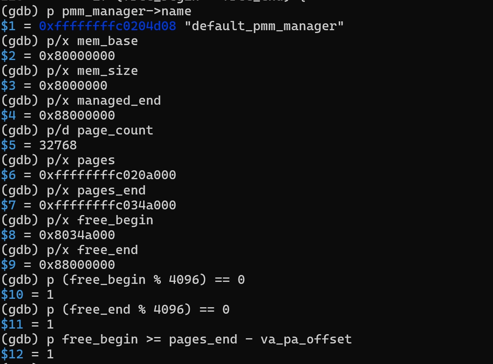
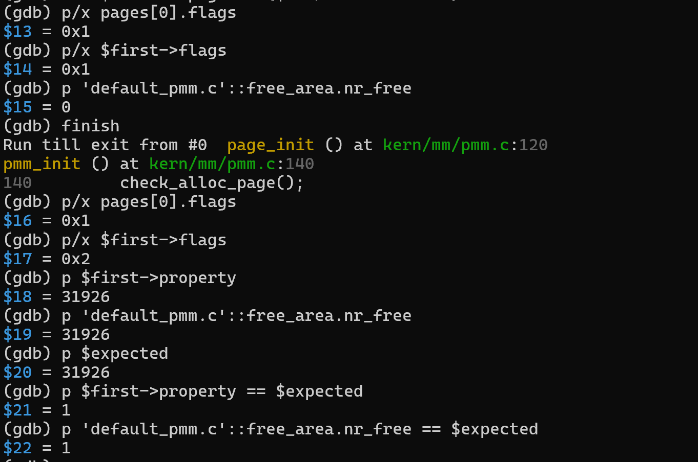
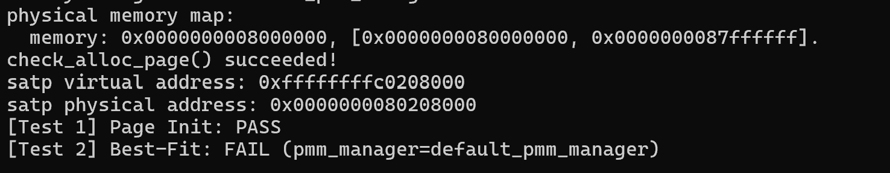

# 操作系统实验报告

## 实验基本信息

| 项目 | 内容 |
|------|------|
| 实验名称 | Lab 2：物理内存和页表 |
| 小组成员 | 2411259-成钧翔（A）、2412224-王泊凯（B）、2413551-李睿（C） |
| 完成日期 | 待全组实验及报告完成后填写 |
| 本次整理日期 | 2026-10-24 |
| 代码分支 | `os_project` 仓库的 `Lab2` 分支 |
| 本次源码核对基线 | `f84e22c5f4f806d5a3501870d6e4ab88ca11a133` |
| A 的实现提交 | `87f3c095f65ab14920ed60995d9f4c192332c4f1`，`Lab2: implement page_init (2411259)` |

**本次填写范围：** A 的物理内存初始化、已有验证、硬件内存范围思考题，以及双 GDB 调试已经完成的准备工作。B、C 的实现与测试章节暂留待填。本报告尚不是全组实验全部完成的终稿。

本报告根据本地 `lab2手册` 中的实验要求，结合 `Lab2` 分支源码和运行截图编写。A 部分按照“理解内存布局与接口 → 明确功能需求与边界 → 编写提示词 → 检查生成代码 → 编译、运行与 GDB 验证”的过程展开。截图来自 A 独立验证阶段，其地址数值仅对应当时的构建。

### 小组分工

| 成员 | 负责的练习/模块 | 本次报告填写范围 |
|------|----------------|------------------|
| 2411259-成钧翔（A） | `page_init()`；双 GDB 页表查询调试；整合与报告汇总 | 已有实现、验证和准备性调试；尚缺内容明确标记 |
| 2412224-王泊凯（B） | First-Fit 分析及 Best-Fit 分配器 | 本次暂不填写 |
| 2413551-李睿（C） | Buddy System 分配器及相应测试 | 本次暂不填写 |

各成员负责本人模块的需求分析、提示词设计和结果验证，A 先编写公共部分与本人负责的内容，后续再汇总 B、C 的材料。

---

## 一、实验目的

1. 理解内核如何从设备树获得物理内存范围，并建立物理页描述符。
2. 区分虚拟地址、物理地址、物理页号与 `struct Page` 描述符地址。
3. 理解保留区域、页对齐和空闲区登记的关系，避免把内核及管理数据交给分配器。
4. 理解 `pmm_manager` 如何把内存初始化与具体分配策略连接起来。
5. 理解页表和 TLB 的作用，准备通过双 GDB 调试观察 QEMU 中的地址翻译过程。
6. 学习把任务整理为可检查的 spec 与 prompt，并用源码、编译、运行和 GDB 核验 AI 输出。

---

## 二、实验环境

### 2.1 A 部分实际使用的环境

| 项目 | 环境与说明 |
|------|------------|
| 宿主系统 | Windows + WSL2 |
| WSL 发行版 | Ubuntu 26.04.1 LTS |
| WSL 内核 | `6.18.33.2-microsoft-standard-WSL2` |
| 交叉编译器 | `riscv64-unknown-elf-gcc 15.1.0` |
| 工具链前缀 | `/opt/riscv-elf-toolchains/bin/riscv64-unknown-elf-` |
| 实验用模拟器 | QEMU 4.1.1，带调试信息构建，未执行 `make install` |
| QEMU 路径 | `/home/lab/tools/qemu-4.1.1/riscv64-softmmu/qemu-system-riscv64` |
| 客体调试器 | `riscv64-unknown-elf-gdb`，连接 QEMU GDB stub |
| A 阶段截图的验证目录 | `/home/lab/lab2_a_validation` |
| 当前源码位置 | `code/`；报告及图片位于 `report/` |

系统原有 QEMU 与实验所用 QEMU 分开保留，运行时显式指定 QEMU 4.1.1 的路径。以上仅描述 A 的环境，不推断 B、C 使用相同环境。

### 2.2 AI 工具

| 成员 | AI 编程工具 | 底层模型 | 说明 |
|------|------------|----------|------|
| 2411259-成钧翔（A） | Codex 桌面应用 | `gpt-5.6-sol`（实现阶段）；`gpt-6.1-sol`（后续调试与报告整理） | 根据功能需求和接口约束编写提示词，借助 AI 生成代码，再检查实现并分析验证结果 |
| 2412224-王泊凯（B） | 待 B 部分整理时填写 | 待填写 | 本次暂不填写 |
| 2413551-李睿（C） | VS Code | `deepseek_v4_pro` | 保留原模板已填写的信息，详细记录待 C 部分整理 |

---

## 三、实验整体逻辑分析

### 3.1 逻辑主线

本实验的核心是先确定“哪些物理页能够使用”，再解决“如何分配和回收这些页”。设备树提供 DRAM 的起点和大小，但其中并非全部空间都能作为空闲页：固件、内核镜像以及内核维护的页描述符都占用内存，需要先保留。

`page_init()` 根据设备树信息和链接符号 `end` 建立 `pages[]`，初始化所有页的管理状态，再将剩余完整页面交给当前分配器。它负责初始布局，不负责决定分配时选择哪一个空闲块。不同分配器经由统一的 `pmm_manager` 接口接入。

```text
内核读取并解析 DTB
  └─ pmm_init()
       ├─ init_pmm_manager()         选择并初始化分配器
       ├─ page_init()                建立物理页描述符布局
       │    └─ init_memmap()         登记合法的初始空闲页
       └─ check_alloc_page()         调用当前分配器的自检

后续 alloc_pages()/free_pages()
  └─ 转发至当前 pmm_manager 的实现
```

地址翻译与页面分配是相关但不同的机制：页表决定虚拟地址如何映射到物理地址，分配器管理可用物理页。本框架在启动汇编中已经建立 Sv39 映射，不能把 `page_init()` 写成开启分页的函数。双 GDB 分支任务是在这一基础上观察 uCore 访存和 QEMU 模拟地址翻译的过程。

### 3.2 功能之间的依赖

1. 解析设备树，为内存布局计算提供物理范围。
2. 初始化当前管理器，使它能够接收初始空闲区。
3. 执行 `page_init()`，保留已占用区域并登记可分配页面。
4. 通过分配器接口申请和回收页面，验证布局与管理状态。
5. 使用 GDB 检查关键状态，再通过双 GDB 调试进一步观察页表和 TLB。

分配算法的具体实现、比较和测试由 B、C 章节后续补充，本次不作其完成情况的验收结论。

---

## 四、实验内容与实现

### 4.1 A：物理内存探测与页描述符初始化

**负责人：** 2411259-成钧翔。

**源码：** [`code/kern/mm/pmm.c`](../code/kern/mm/pmm.c)，保留 `//lab2 function1 2411259` 注释。

#### 4.1.1 模块功能描述

**需要实现的函数：**

```c
static void page_init(void);
```

`page_init()` 根据设备树提供的物理内存范围建立 `struct Page` 描述符数组，并把排除 OpenSBI、内核镜像和描述符数组后的完整空闲页面注册给当前 `pmm_manager`。成功完成后，以下全局状态必须有效：

- `va_pa_offset`：内核虚拟地址与物理地址之间的线性映射偏移；
- `npage`：可管理物理地址上界对应的物理页号；
- `pages`：物理页描述符数组的内核虚拟地址；
- 分配器的初始空闲区：从描述符数组结束后的第一个完整页面开始，到可管理物理内存末尾结束。

#### 4.1.2 功能 Spec

**前置条件：**

1. DTB 初始化已经完成，`get_memory_base()` 和 `get_memory_size()` 可用；
2. 链接符号 `end` 指向内核镜像末尾；
3. 当前 `pmm_manager` 已选择并完成自身初始化；
4. 地址转换、页面大小和页面状态宏可用。

**后置条件：**

1. DTB 返回的内存范围有效，否则通过 `panic()` 终止；
2. `va_pa_offset == PHYSICAL_MEMORY_OFFSET`；
3. 可管理上界不超过框架允许的物理内存上界，并按页向下对齐；
4. `npage` 与可管理物理内存末端相符；
5. `pages` 位于 `ROUNDUP(end, PGSIZE)`；
6. 所有页描述符先初始化为保留状态且引用计数为 0；
7. 内核镜像及 `pages[]` 自身占用的页面保持保留；
8. 只有描述符数组之后的完整页面进入空闲区；
9. 没有完整空闲页时不得调用 `init_memmap()`；
10. 输出实际探测到的物理内存范围。

#### 4.1.3 提示词设计思路与最终提示词

在理解设备树、页描述符和分配器接口后，我先明确本模块的职责：确定可管理的物理页，保留已占用区域，并把合法空闲页交给当前分配器，而不是在本函数中决定分配策略。我据此编写提示词，并将需求组织成四部分：

- **Prompt：说明要解决的问题。** 描述输入信息、模块职责和允许修改的范围，避免只给出“实现函数”的笼统要求。
- **Rely：列出必要依赖。** 明确 DTB 查询接口、链接符号、页描述符、地址转换与对齐宏，不要求修改启动链、公共结构或其他分配器。
- **Guarantee：限定责任与结果。** 要求正确设置全局状态，保留内核及管理数据占用的页面，只登记合法完整空闲页。
- **Specification：写出可检查的行为。** 明确无效内存范围、溢出、页对齐、空闲区登记条件，以及编译、运行和 GDB 检查要求。

下面给出按上述要求组织的完整提示词，汇总版本见 [A 部分提示词](./prompt.md#任务一物理内存探测与页描述符初始化)。

````markdown
请在当前 uCore Lab2 项目中实现 kern/mm/pmm.c 的 page_init()，并在 WSL 中实际编译、运行和使用 GDB 验证。

[Prompt]
根据 DTB 返回的物理内存起点和大小，建立可管理物理页的 struct Page 描述符布局，并将排除 OpenSBI、内核镜像和描述符数组占用空间后的完整空闲页面交给当前 pmm_manager。仅修改 page_init() 对应的 lab2 实现区域，不修改测试、公共结构或其他分配器。

[Rely]
只依赖 get_memory_base()、get_memory_size()、panic()、cprintf()、init_memmap()、pa2page()、链接符号 end、struct Page，以及现有的 DRAM_BASE、PHYSICAL_MEMORY_END、PHYSICAL_MEMORY_OFFSET、PADDR、PPN、ROUNDUP、ROUNDDOWN 和页面状态宏。

[Guarantee]
正确设置 va_pa_offset、npage 和 pages；初始化所有 Page；保持内核与描述符数组占用页面为 reserved；仅把合法完整空闲页注册给分配器；保留原有接口和工程语义。

[Specification]
检查 DTB 范围为非零且加法不溢出；确认内存起点符合平台布局；管理上界不得超过框架上限；pages 必须页对齐并位于内核 end 之后；检查描述符数组大小计算和地址加法是否溢出，并核验实际运行中的数组布局；free_begin 必须位于描述符数组之后并向上页对齐；只有 free_begin < free_end 时调用 init_memmap()。完成后执行现有页面初始化测试，并用 GDB 检查关键全局变量和 reserved 状态。
````

#### 4.1.4 核心实现逻辑

实现按以下关系计算内存布局：

```text
mem_base    = get_memory_base()
mem_end     = mem_base + get_memory_size()
managed_end = min(mem_end, PHYSICAL_MEMORY_END)，随后按页向下对齐
npage       = PPN(managed_end)
pages       = ROUNDUP(end, PGSIZE)
pages_end   = pages + (npage - nbase) * sizeof(struct Page)
free_begin  = ROUNDUP(PADDR(pages_end), PGSIZE)
free_end    = managed_end
```

`pages[]` 为从 `nbase` 到 `npage` 范围内的每个物理页提供描述符。初始化时先把所有描述符设置为 reserved，并清空 `property` 和引用计数。这种“先全部保留、再释放合法区间”的方法能够避免遗漏内核或管理数据占用的页面。

当 `free_begin < free_end` 时，通过：

```c
init_memmap(pa2page(free_begin),
            (free_end - free_begin) / PGSIZE);
```

把完整空闲页交给当前分配器。`page_init()` 不直接决定使用 First-Fit、Best-Fit 还是 Buddy System，从而保持探测逻辑与分配策略解耦。

#### 4.1.5 关键检查与实现边界

| 检查位置 | 当前源码的处理 |
|----------|----------------|
| DTB 内存范围 | 起点或大小为零、末端加法回绕时 `panic()` |
| 平台内存起点 | 当前实现要求 `mem_base == DRAM_BASE`，否则终止 |
| 管理上界 | 不超过 `PHYSICAL_MEMORY_END`，并按页向下对齐 |
| 物理页范围 | 检查 `npage > nbase` |
| 描述符数量与地址计算 | 检查数量乘法和地址加法溢出 |
| 页面初始状态 | 逐页清 `flags`、`property`、引用计数，再设置 `PG_reserved` |
| 空闲区登记 | `free_begin < free_end` 时才调用 `init_memmap()` |

`npage` 是管理末端对应的物理页号，不是 `pages[]` 的元素个数。数组实际元素数为 `npage - nbase`，物理页号为 `ppn` 的页对应 `pages[ppn - nbase]`。混淆这两者会导致数组大小和描述符索引计算错误。

当前实现针对框架的单段 DRAM 布局；本报告不将它描述为已经支持任意起点、多个离散内存区或内存热插拔。已有截图验证了正常实验配置的布局，未逐项运行零大小、溢出和无空闲完整页等异常输入，因此不宣称已经完成全部异常路径的动态测试。

#### 4.1.6 实现与验证过程中的实际问题

实现和验证过程中，需要分别判断功能实现、工程构建和运行环境的问题，主要处理了以下情况。

**问题一：系统 QEMU 下的启动异常。** A 阶段使用系统 QEMU 10.2.1 启动时，记录到执行页异常，无法完成预期验证。随后按照本地手册示例，单独编译并使用带调试信息的 QEMU 4.1.1，成功进入内核。报告保留这一环境切换事实，不把尚未通过单独分析证明的启动异常根因归结为 `page_init()`。

**问题二：当时未完成的 Best-Fit 骨架阻塞全工程编译。** 构建系统会编译 `kern/mm` 中的源文件，即使尚未选择相应管理器，未完成文件也可能导致构建失败。A 阶段在隔离验证副本中使用基于框架 First-Fit 的可编译占位，验证 `page_init()`，没有把这一占位实现作为 B 的成果。当前整合源码已不同于当时的骨架阶段，不能将该历史问题写成当前阻塞。

**问题三：地址与标志的证据必须对应同一次构建。** 为观察局部变量，截图阶段使用 `DEFS="-O0 -fno-inline"` 重新编译。内核大小变化会移动 `end`、`pages` 和空闲区起点，因此具体地址以各次日志或截图为准。比较虚拟的 `pages_end` 和物理的 `free_begin` 时，必须先转换到同一地址空间。

**本模块验证结果：** `page_init()` 已实现并提交；A 独立副本编译、启动成功；GDB 观察到正确的保留页和空闲块状态；页面初始化测试输出 `[Test 1] Page Init: PASS`。具体截图与验证范围见第五节。这些结论不等于完整双 GDB 地址翻译任务已完成。

### 4.2 B：First-Fit 分析与 Best-Fit 分配器

**负责人：** 2412224-王泊凯。

本次暂不填写本模块的实现、prompt、迭代、思考题与验证内容，后续由 B 材料整理补充。

### 4.3 C：Buddy System 分配器与测试

**负责人：** 2413551-李睿。

本次暂不填写本模块的实现、两份 prompt、测试覆盖及迭代记录，后续根据 C 的最终代码与真实材料补充。

### 4.4 A：分支任务——双 GDB 调试页表查询过程

#### 4.4.1 目标与两个调试器的职责

客体侧 RISC-V GDB 连接 QEMU 的 GDB stub，用来控制 uCore、选择访存指令并读取客体寄存器与地址。宿主侧 GDB 调试运行 QEMU 的进程，用来观察 QEMU 源码中的地址翻译、软件 TLB 与页表遍历。

目前已完成带调试信息的 QEMU 4.1.1 构建、客体 GDB 连接，以及第五节展示的 `page_init()` 局部变量和状态检查。宿主 QEMU 的地址翻译调用链仍需继续调试并补充记录。

#### 4.4.2 对照手册的记录状态

| 手册要求 | 现有记录 | 尚需补充 |
|----------|----------|----------|
| 实际虚拟地址如何翻译为物理地址，给出 QEMU 关键路径和分支 | 已有客体调试准备 | 选定访存指令、地址及实际调用链、分支记录 |
| 单步解释页表翻译流程 | 尚无完整单步记录 | SATP、各级索引、PTE 地址与值、最终物理地址 |
| 定位并调试 QEMU 的软件 TLB 查询 | 尚无完成证据 | 实际源码位置、命中与未命中路径 |
| 比较 QEMU TLB 与真实 CPU TLB，并比较分页开关前后 | 尚无实测对照 | 开启分页前后的实际调用路径及分析 |
| 记录调试中观察到的细节与收获 | 已有内存布局和标志检查 | 地址翻译与 TLB 调试中的实际观察 |
| 记录借助大模型解决问题的过程 | 已整理 A 阶段环境与布局问题 | 双 GDB 任务的具体情景、交互与解决证据 |

后续记录应包含可复现的断点命令、访存指令和虚拟地址、实际源码行、关键寄存器与 PTE、最终物理地址及截图。没有运行得到的值暂不填写，不用理论推导冒充调试结果。

### 4.5 A：硬件可用物理内存范围思考题

**问题：如果 OS 无法提前知道硬件的可用物理内存范围，如何获取？**

内核应读取固件或启动程序提供的内存地图，而不是假定内存大小固定。本实验由设备树的内存节点提供 DRAM 起点和长度，启动链把 DTB 交给内核，解析结果经 `get_memory_base()`、`get_memory_size()` 使用。其他平台也可由 BIOS 内存地图或 UEFI memory map 等接口提供可用与保留区域。

获得 RAM 范围后，内核仍需扣除固件、内核镜像、页表、管理结构和其他保留区，再按页对齐登记可用区域。不能通过任意读写所有物理地址来替代可靠的内存地图，因为访问可能触发异常或影响 MMIO 设备。

本实现按照当前框架的一段 DRAM 管理，若要支持多个离散可用区，还需要逐段处理范围与保留区域；这一扩展未在本次代码中实现。

### 4.6 选做 Challenge：SLUB

本地手册将 SLUB 列为选做 Challenge。本次未整理或实现该部分，不填入完成结果。

---

## 五、测试与验证

### 5.1 A 部分独立验证

#### 5.1.1 验证范围与环境

以下三张已有截图来自 WSL 中的 `/home/lab/lab2_a_validation`，对应只完成 A 的 `page_init()`、尚未接入 B 和 C 的阶段。当前管理器为框架提供的 `default_pmm_manager`（First-Fit），未使用 `lab2_B_complete` 或 `lab2_C_complete` 的分配算法实现。

由于原始 Best-Fit 骨架会阻塞全工程编译，独立验证副本中采用基于现有 First-Fit 的编译占位，并接入课程提供的页面初始化测试。该副本包含验证所需的辅助改动，不是原封不动的提交目录；A 正式提交的实现仍为 `pmm.c` 中的 `page_init()`。该次调试使用 `DEFS="-O0 -fno-inline"` 重新编译，方便观察局部变量；RISC-V GDB 连接 QEMU 4.1.1 的 GDB stub。

#### 5.1.2 截图一：空闲区登记前的内存布局

在 `kern/mm/pmm.c:120` 设置临时断点，即完成所有描述符初始化、即将判断是否调用 `init_memmap()` 的位置。实际观察如下：

| 变量 | 截图中的结果 | 含义 |
|------|--------------|------|
| `pmm_manager->name` | `default_pmm_manager` | A 阶段使用原有 First-Fit |
| `mem_base` | `0x80000000` | DRAM 物理起点 |
| `mem_size` | `0x08000000` | 128 MiB |
| `managed_end` | `0x88000000` | 管理区物理末端，右开边界 |
| `page_count` | `32768` | 本次建立的物理页描述符数量 |
| `pages` | `0xffffffffc020a000` | 描述符数组虚拟起点 |
| `pages_end` | `0xffffffffc034a000` | 描述符数组虚拟末端 |
| `free_begin` | `0x8034a000` | 最终空闲区物理起点 |
| `free_end` | `0x88000000` | 最终空闲区物理末端 |

截图中，`free_begin % 4096 == 0`、`free_end % 4096 == 0` 和 `free_begin >= pages_end - va_pa_offset` 的结果均为 1，分别证明空闲区两端按页对齐，且没有覆盖描述符数组。`pages_end` 是虚拟地址，必须减去映射偏移后才能与物理地址 `free_begin` 比较。



#### 5.1.3 截图二：空闲区登记前后的页面状态

在同一断点保存 `$fb = free_begin`、`$fe = free_end`，令 `$expected = ($fe - $fb) / 4096`，并令 `$first = pages + ($fb / 4096 - nbase)` 指向第一个可用物理页的描述符。随后使用 `finish` 执行完 `page_init()`，比较登记前后的状态：

| 检查项 | 登记前 | `page_init()` 返回后 |
|--------|--------|---------------------|
| `pages[0].flags` | `0x1` | `0x1` |
| `$first->flags` | `0x1` | `0x2` |
| `default_pmm.c` 中的 `free_area.nr_free` | `0` | `31926` |
| `$first->property` | 尚未登记为空闲块 | `31926` |
| `$expected` | `31926` | `31926` |

`pages[0]` 对应 DRAM 起点的物理页，位于本实验的 OpenSBI 保留区，因此始终保留 `PG_reserved`（`flags = 0x1`）。第一个可用页由保留状态变为带 `PG_property` 的空闲块首页（`flags = 0x2`），表明空闲区已交给分配器。其余空闲块内部页面不要求设置 `PG_property`。

该次可用页数计算为：

```text
(0x88000000 - 0x8034a000) / 0x1000 = 31926
```

截图中，`$first->property == $expected` 和 `'default_pmm.c'::free_area.nr_free == $expected` 的结果均为 1。它们验证了空闲块大小、分配器计数和实际区间计算结果一致。



#### 5.1.4 截图三：A 阶段运行测试

继续执行后，终端实际输出包含：

```text
physical memory map:
  memory: 0x0000000008000000, [0x0000000080000000, 0x0000000087ffffff].
check_alloc_page() succeeded!
satp virtual address: 0xffffffffc0208000
satp physical address: 0x0000000080208000
[Test 1] Page Init: PASS
[Test 2] Best-Fit: FAIL (pmm_manager=default_pmm_manager)
```



`check_alloc_page() succeeded!` 表示当前默认分配器自检通过；`[Test 1] Page Init: PASS` 是页面初始化测试的直接结果。`[Test 2]` 明确报告当前管理器为 `default_pmm_manager`，因此此时 Best-Fit 项不通过属于 A 阶段的预期结果，不能据此判定 A 失败，也不能据此宣称 B 已通过。

这里打印的 `satp virtual address` 与 `satp physical address` 是启动根页表的地址，不是 `satp` 寄存器的原始值；两者相差 `0xffffffff40000000`，与内核直接映射偏移一致。这张图不构成完整页表遍历或 TLB 命中过程的证据。本次暂不填写 B、C 的独立验证结果。

### 5.2 复现要点与证据边界

A 阶段验证在独立目录完成，使用 `default_pmm_manager`，并对当时尚未完成的分配器骨架作了编译占位处理。截图对应这一验证配置。当前分支中的 `page_init()` 与 A 提交的函数内容一致，截图中的具体地址仍以当时构建为准。

以下为 A 阶段独立验证的复现步骤，应在准备好的隔离目录执行；当前整合源码与截图配置不同，复现时保留仓库中的管理器选择和 B、C 实现。

```bash
cd /home/lab/lab2_a_validation
GCCPREFIX=/opt/riscv-elf-toolchains/bin/riscv64-unknown-elf-
QEMU=/home/lab/tools/qemu-4.1.1/riscv64-softmmu/qemu-system-riscv64
make clean
make GCCPREFIX="$GCCPREFIX" DEFS="-O0 -fno-inline" -j2
make GCCPREFIX="$GCCPREFIX" QEMU="$QEMU" debug
```

另开终端连接客体调试器，断点应根据该副本源码实际位置设置，不把历史行号当成固定接口：

```text
riscv64-unknown-elf-gdb bin/kernel
(gdb) target remote :1234
(gdb) break page_init
(gdb) continue
```

第五节截图展示了后续检查命令：读取内存范围、描述符数组边界和空闲区边界；在登记前保存首个可用页描述符；执行 `finish` 后比较标志、块大小与空闲页计数。

上述记录支持 A 的正常配置验证。它们不包含全组最终 `make grade` 的通过截图，也没有覆盖所有异常 DTB 输入；双 GDB 调试完成后仍需补充宿主 QEMU 的完整日志和截图。

---

## 六、实验总结与收获（A 部分）

### 6.1 重要知识点及其与 OS 原理的联系

| 知识点 | 本实验中的体现 | 与 OS 原理的联系及边界 |
|--------|----------------|------------------------|
| 物理内存地图 | 从 DTB 获取 DRAM 起点和长度 | 平台提供原始范围，内核进一步排除已占用区域；本实现不是通用多区域探测器 |
| 页框管理与元数据 | 每个页框对应一个 `struct Page` | 描述符存放管理状态，并非页框内容本身；管理元数据同样占用物理内存 |
| 地址空间转换 | `PADDR`、物理页号、`pages[ppn-nbase]` | 线性映射的算术转换和硬件页表翻译需要区分；不能混用地址与数组索引 |
| 对齐与保留区 | 上界向下对齐，空闲起点向上对齐 | 只登记完整页面，避免将内核或描述符尾部所在页重复分配 |
| 接口与策略分离 | `page_init()` 通过 `init_memmap()` 接入分配器 | 内存布局初始化不决定具体分配策略，统一接口降低模块耦合 |
| 页表与 TLB | 启动映射、根页表地址及后续调试目标 | 用于虚拟地址翻译；当前客体状态检查尚不等于完成软件 TLB 与页表遍历的实测 |

### 6.2 OS 原理中重要但本部分尚未覆盖的内容

1. 用户进程独立地址空间的建立、切换和销毁。
2. 缺页异常、按需分页、页面置换和交换。
3. 写时复制、共享内存与文件映射。
4. 多核页表更新、TLB 一致性和 TLB shootdown。
5. NUMA、内存热插拔、并发分配器同步与复杂保留区域处理。

### 6.3 AI 协作开发的实际经验

**先理解模块职责，再设计提示词。** 我先梳理 `page_init()` 与 DTB、链接符号、全局变量及管理器初始化顺序的关系，明确它负责页级内存布局而非分配策略，再把目标、依赖、责任和检查条件写入提示词。AI 根据这些需求生成实现代码，我结合源码与运行结果分析是否符合预期。

**把理解转化为可核验条件。** 理解页描述符也会占用物理内存后，我在提示词中要求保留描述符数组所在区域；理解页面分配以整页为单位后，我明确空闲区两端的对齐条件。通过 GDB 比较保留标志、空闲块大小和计数，可以进一步检验这些要求是否落实。

**区分环境问题、算法结果与任务完成状态。** 编译失败可能来自尚未完成的其他源文件，启动异常也不能直接推断为本函数错误。隔离副本可以验证 A，但报告必须说明辅助改动；客体 GDB 检查通过，也不能替代双 GDB 分支任务。

**保留真实结果及其上下文。** 截图中第二项 Best-Fit 失败与 A 阶段使用 First-Fit 的配置有关，应完整保留并解释，不能裁掉失败行后宣称全部通过。尚未完成的双 GDB 调试仍保留待补充状态。

---

## 附录：本次可填写状态与后续补充项

| 项目 | 状态 |
|------|------|
| A 的 `page_init()` 功能说明、spec、实现分析 | 已填写，并对照当前分支源码 |
| A 的最终规格 prompt | 已按 Prompt、Rely、Guarantee、Specification 四部分填写，并汇总到 `prompt.md` |
| A 的历史独立验证 | 已附三张真实截图并解释范围、地址和状态变化 |
| 硬件内存范围思考题、A 的知识点及 AI 经验 | 已填写 |
| 双 GDB 地址翻译、TLB 及分页开关对比 | 已填写准备情况；完整实测过程待补充 |
| A 的姓名、学号和 AI 工具 | 已填写 |
| B、C 报告章节与全组最终验证 | 本次暂不填写 |
| 全组完成日期 | 待全部任务及报告完成后填写 |

本次参考本地《练习》（第 1 页的物理内存初始化及内存范围思考题）、《实验报告要求》、《分支任务：gdb 调试页表查询过程》（第 6—7 页的调试要求）及《项目组成》。这些 PDF 位于本机 `lab2手册` 文件夹，本次未上传手册，也未访问手册网站。

可在仓库中直接核对的文件：[`pmm.c`](../code/kern/mm/pmm.c)、[`pmm.h`](../code/kern/mm/pmm.h)、[`memlayout.h`](../code/kern/mm/memlayout.h)、[`dtb.c`](../code/kern/driver/dtb.c)。
