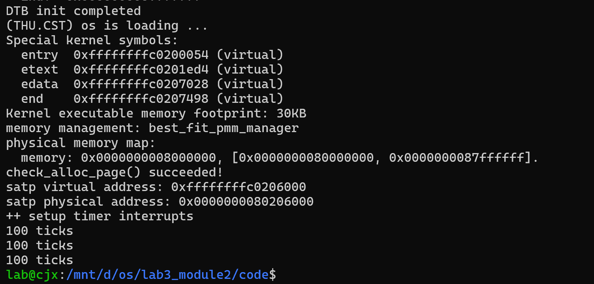
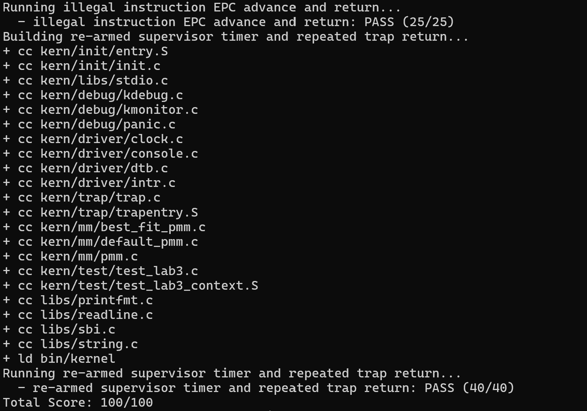

# 操作系统实验报告

## 实验基本信息

| 项目 | 内容 |
|------|------|
| **实验名称** | Lab 3: 断，都可以断 |
| **小组成员** | 2413551-李睿、2411259-成钧翔、学号3-姓名3 |
| **完成日期** | 2026-11-05 |

### 小组分工

练习如何分工？

| 成员 | 负责的练习/模块 |
|------|----------------|
| 2413551-李睿 | 功能模块一 |
| 2411259-成钧翔 | 功能模块二：中断与异常处理 |
| 学号3-姓名3 | [练习或模块名称] |

实验报告如何分工？

---

## 一、实验目的

<!-- 说明本次实验的主要目标和预期成果 -->

本实验的主要目的是：

1. [目的1：例如，理解用户态进程如何通过系统调用进入内核]
2. [目的2：例如，掌握进程创建、执行、退出的完整生命周期]
3. [目的3：例如，学习使用 AI 辅助开发操作系统核心功能]

---

## 二、实验环境

你们使用的 AI 工具

| 成员 | AI 编程工具 | 底层模型 | 备注 |
|------|------------|---------|------|
| 2413551-李睿 | VS Code 插件 | DeepSeek-V4-Flash | 无 |
| 2411259-成钧翔 | Codex 桌面应用 | 未记录 | 辅助实现与验证模块二 |
| 学号3-姓名3 | | | |

**说明：**
- **AI 编程工具**：指具体使用的终端工具、编辑器插件、桌面应用或浏览器界面
- **底层模型**：指该工具使用的大语言模型及版本

---

## 三、实验整体逻辑分析

### 2.1 本章节的逻辑主线

[请用自己的话描述本章实验的核心主线，例如：
- 本章围绕哪个核心主题展开？（例如：用户进程管理、虚拟内存、文件系统等）
- 整个实验解决什么问题？（例如：如何让用户程序运行在操作系统之上）]

### 2.2 功能的逐步实现

[说明本章实验是按照什么顺序逐步实现各个功能的，以及为什么要按这个顺序，例如：

1. 首先实现**功能A** → 为什么首先实现这个？（例如：建立系统调用接口是后续所有用户态功能的基础）
2. 接着再完善**功能B** → 为什么接着实现这个？（例如：有了系统调用后，需要能够加载和启动第一个用户进程）
3. 然后完成**功能C** → 为什么然后实现这个？（例如：有了第一个进程后，需要实现进程复制功能）
4. 最后补充了**功能D** → 为什么最后实现这个？（例如：最后完善进程退出和清理机制，形成完整闭环）]

---

## 四、实验内容与实现

<!-- 
说明：本部分按照 exercises 文档中的练习顺序组织
每个功能模块或者练习中可能包含多项任务，请根据实际情况调整
-->

### 功能模块：Trap 上下文恢复与 Trap 入口功能

**负责人：** [2413551-李睿]

#### 模块功能描述

**需要实现/修改的函数：**

```c
// 列出本模块涉及的所有函数签名
void example_function(void);
int another_function(int arg);
```

**功能说明：**

[简要描述该模块的功能，包括：
- 该模块在整个系统中的作用
- 需要处理的主要场景
- 与其他模块的交互关系]

#### 最终提示词

以下是经过迭代优化后，最终成功实现该功能的提示词：

````markdown

[按照提示词模板，给出具体的提示词]

````

#### 实现迭代过程

本模块的实现经历了 [N] 次迭代，过程如下：

---

##### 第一次迭代

如果设计的prompt生成代码后出现问题：

**遇到的问题：**
- 问题1：问题描述、错误信息和原因分析
- 问题2：问题描述、错误信息和原因分析

**问题解决策略：**
- 针对问题1：[说明如何修改提示词]
- 针对问题2：[说明如何修改提示词]

如果没有问题：

**最终结果：**

经过 [N] 次迭代，该模块最终：
- ✅ 编译通过
- ✅ 所有相关测试通过
- ✅ 功能符合预期

**关键改进点总结（如有）：**
1. [改进点1：例如，在 [RELY] 中补充了完整的系统调用号定义]
2. [改进点2：例如，在 [SPECIFICATION] 中明确了异常处理的边界条件]
3. [改进点3：例如，增加了对用户指针合法性检查的要求]

---

##### 第二次迭代（如有）

[按照和第一次迭代相同的格式]

---

##### 第三次迭代（如有）

[按照和第一次迭代相同的格式]

---

### 功能模块二：中断与异常处理

**负责人：** 2411259-成钧翔

本模块在 `kern/trap/trap.c` 中实现 `interrupt_handler()` 和 `exception_handler()`。已有的 `trap_dispatch()` 区分中断和异常；两个处理函数根据 TrapFrame 中的原因执行相应操作，再交回框架统一恢复现场。

- **中断处理：**去掉 `cause` 的最高位中断标志后识别类型。每次 S 模式时钟中断都安排下一次事件并递增 `ticks`，每满 100 次打印一行 `100 ticks`。当前实现默认打印三次后调用 `sbi_shutdown()`。其他已知中断打印类型，未知中断打印编号和 TrapFrame。处理中断时不修改返回地址。
- **异常处理：**对非法指令和断点输出触发地址，并读取该地址处指令的低半字。在本实验的 16 位和 32 位指令范围内，根据低两位分别将 `tf->epc` 增加 2 或 4，使返回后从下一条指令执行。其余异常只转储 TrapFrame。

**提示词与验证：**[提示词汇总](./prompt.md)中的模块二约束了修改范围、返回地址更新规则及预期输出。测试时用 `DEFS=-Dsbadaddr=stval` 适配本机汇编器，保留模块一源文件和课程评分脚本。普通启动连续输出三次时钟统计后正常退出；课程测试中的非法指令返回为 **25/25**、持续时钟中断为 **40/40**，整合测试总分为 **100/100**，见第五节。

---

### Challenge：[Challenge标题]

**负责人：** [学号-姓名]

[按照Challenge的具体要求进行解答]

---

## 五、测试与验证

### 5.1 QEMU 正常启动与时钟中断

在 WSL 中编译内核并运行 `make qemu`。启动日志显示 Best-Fit 自检成功，随后内核设置时钟中断，连续输出三次 `100 ticks`，达到当前实现的统计阈值后关机，终端返回命令提示符。



### 5.2 课程评分测试

运行框架自带的 `make grade`，检查 Trap 入口、寄存器恢复与断点返回，非法指令处理与返回，以及持续时钟中断。截图保留了非法指令返回 `25/25`、持续时钟中断 `40/40` 和总分 `100/100`；较早输出的 Trap 入口测试未截入画面。



本机测试时使用 `DEFS=-Dsbadaddr=stval` 兼容汇编器对 CSR 名称的要求。普通启动用于验证定时器和关机，断点与非法指令由评分测试主动触发。

---

## 六、实验总结与收获

### 对操作系统的理解

1. 列出你们认为本实验中重要的知识点，以及与对应的 OS 原理中的知识点，并简要说明二者的含义、关系和差异
2. 列出你们认为 OS 原理中很重要、但在本实验中没有对应上的知识点

### AI 协作开发的经验

[写出你们在与 AI 协作过程中实际收获的经验或者感悟]

---

